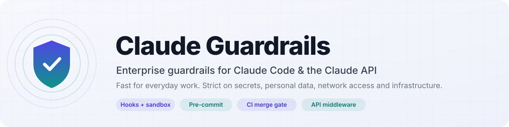
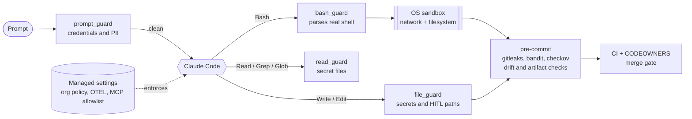

<p align="center">
  <picture>
    <source media="(prefers-color-scheme: dark)" srcset="docs/assets/banner-dark.svg">
    
  </picture>
</p>

<p align="center">
  <a href="https://github.com/pixelofsoftware/AI-Mods/actions/workflows/ai-guardrails.yml"></a>
  <a href="LICENSE"></a>
  
  
  <a href="https://pre-commit.com"></a>
  <a href="#contributing"></a>
</p>

<p align="center">
  <a href="#installation"><b>Install</b></a> ·
  <a href="#guardrails"><b>Guardrails</b></a> ·
  <a href="#documentation"><b>Docs</b></a> ·
  <a href="#see-it-in-action"><b>See it in action</b></a> ·
  <a href="#how-it-works"><b>How it works</b></a>
</p>

---

**Claude Guardrails** is a drop-in framework for teams that want to use [Claude Code](https://code.claude.com) and the Claude API on real codebases **without** handing an AI agent your secrets, your customers' data or your production infrastructure.

It is built around one idea: **the safe path has to be the fast path.** Routine work (reading code, running tests, refactoring, writing docs) flows without approval prompts. Guardrails engage only where the risk is real: credentials, personal data, arbitrary network access, infrastructure changes, and the guardrails themselves. Developers then have no reason to reach for unapproved "shadow AI" tools.

> [!NOTE]
> This is a community project. It is not affiliated with or endorsed by Anthropic.

## ✨ What you get

<table>
<tr>
<td width="50%" valign="top">

### 🧭 A policy people will actually read
[`docs/claude-guardrails.md`](docs/claude-guardrails.md) is a one-page developer policy covering risk tiers, which permission mode to use when, data-protection rules, mandatory human review for infrastructure and security code, and approved tools. It's written for engineers, not auditors.

</td>
<td width="50%" valign="top">

### 🪝 Claude Code hooks that understand shell
Four Python hooks inspect every prompt, command, file write and file read **before** it happens. They parse real shell syntax (pipelines, heredocs, `bash -c`, `$(…)`, `find -exec`, wrappers), so `/usr/bin/curl` and `bash -c 'curl …'` are caught, not just `curl`.

</td>
</tr>
<tr>
<td valign="top">

### 🔒 Least-privilege configuration
[`.claude/settings.json`](.claude/settings.json) has an allowlist of safe commands, deny rules for secrets and network clients, an OS-level sandbox with a domain allowlist, and bypass mode disabled. [`enterprise/managed-settings.json`](enterprise/managed-settings.json) adds org-wide OpenTelemetry, prompt logging and an MCP server allowlist.

</td>
<td valign="top">

### 🚦 Commit and merge gates
Pre-commit runs **gitleaks**, **bandit**, **checkov** and private-key detection. It also blocks Claude session transcripts, local configs and key files, and fails any commit that weakens the guardrail configuration. CI re-runs everything, so `--no-verify` doesn't get anything past it.

</td>
</tr>
<tr>
<td valign="top">

### 🧰 Middleware for apps built on the Claude API
[`scripts/claude_safeguard.py`](scripts/claude_safeguard.py) wraps the official `anthropic` SDK with PII and credential **redaction before sending**, one **ECS-style JSON audit event** per request for your SIEM, and **output validation** against reverse shells, encoded execution, exfiltration links, invisible Unicode and leaked secrets.

</td>
<td valign="top">

### ✅ Tested and reviewed
More than 300 tests cover the hooks, the middleware and the validators, including regression tests for every finding from the independent security and code-quality reviews and drift tests that keep the configuration lists in sync. The full build record is in [`.sdlc/`](.sdlc/claude-guardrails/).

</td>
</tr>
</table>

<a id="see-it-in-action"></a>

## 🎬 See it in action

These are real outputs from the hooks in this repository.

**Claude tries a pipe-to-shell download, disguised behind `bash -c`.** Denied:

```text
[AI guardrail] `curl` performs arbitrary network requests; use approved tooling or ask a human
to run it; decoded or downloaded content piped into an interpreter.
See docs/claude-guardrails.md#4-tooling-controls
```

**A developer pastes an API key into a prompt.** The prompt is blocked before it reaches Claude, and a redacted copy is offered:

```text
Blocked by AI data-protection policy: the prompt contains API_KEY.
Credentials must never be sent to an AI service. If the value is real, rotate it now.

Redacted version you can resubmit:

Why does auth fail? key=[REDACTED:API_KEY_1]
```

**Claude edits Terraform.** A human approval prompt appears, even in auto-accept modes:

```text
[AI guardrail] `infra/main.tf`: infrastructure-as-code: AI-generated changes require human review before merge (HITL)
```

<details>
<summary><b>More examples</b>: secrets, hardcoded keys, infrastructure</summary>

```text
$ cat .env.production
[AI guardrail] access to secret material `.env.production` is blocked; reference it via env vars or a secret manager.

Read(.env.prod)
[AI guardrail] reading `.env.prod` is blocked: it may contain secrets. Use the matching .example file, or ask the developer for the non-secret value you need.

Write(src/client.py) with a hardcoded key
[AI guardrail] hardcoded credential detected (API_KEY) in `src/client.py`. Read it from an environment variable or the secret manager instead, and rotate the value if it is real.

$ terraform apply -auto-approve
[AI guardrail] `terraform apply` mutates real infrastructure; run it through the reviewed CI pipeline.
```

</details>

**Check text before you paste it**, offline, with no API call:

```console
$ python3 scripts/claude_safeguard.py scan "Refund jane@corp.io, SSN 123-45-6789, card 4012 8888 8888 1881"
{
  "risk_level": "HIGH",
  "redacted_text": "Refund [REDACTED:EMAIL_1], SSN [REDACTED:SSN_1], card [REDACTED:CARD_NUMBER_1]",
  ...
}
```

<a id="how-it-works"></a>

## 🏗️ How it works

Four independent layers. Each one is useful on its own, and none of them relies on Claude behaving well.



| Layer | Lives in | Enforced by | Can a developer turn it off? |
|---|---|---|---|
| **Org policy** | `enterprise/managed-settings.json` | MDM, a system file, or the claude.ai admin console | No |
| **Project policy** | `.claude/settings.json`, `.claude/hooks/`, `.mcp.json` | Claude Code in this repo | Partly, through their own `settings.local.json`; deny rules still apply, the change is gitignored and audited, and CI re-checks the commit |
| **Commit gate** | `.pre-commit-config.yaml`, `scripts/precommit/` | `git commit` / `git push` | Locally yes (`--no-verify`), but CI repeats every check |
| **Merge gate** | `.github/workflows/`, `.github/CODEOWNERS` | Pull requests + branch protection | No |
| **App runtime** | `scripts/claude_safeguard.py` | Your service process | n/a (it's a library) |

### Risk-tiered by design

| Tier | Typical work | Mode | Review |
|---|---|---|---|
| **0: General** | Questions, docs, tests, refactors with tests | Any mode, including auto | Normal PR review |
| **1: Product code** | Features and bug fixes | Manual or accept-edits | Normal PR review |
| **2: Critical** | Terraform, CI/CD, auth, crypto, the guardrails themselves | Plan first, then supervised | **Mandatory code-owner review** |

<a id="quick-start"></a>
<a id="installation"></a>

## 🚀 Installation

Most people only need step 1. Admins, API teams and anyone adopting the guardrails in another repository will find their steps further down.

### 1 · Developers using Claude Code (about 10 minutes)

**Prerequisites**

| Requirement | Check | Notes |
|---|---|---|
| Claude Code, recent release | `claude --version` | Older versions skip newer settings keys with a warning |
| Python 3.9+ as `python3` | `python3 --version` | The hooks use only the standard library |
| git and pre-commit | `pre-commit --version` | The setup script installs pre-commit if it's missing |
| Sandbox tools | Linux/WSL2: `bwrap --version && socat -V` | Debian/Ubuntu: `sudo apt-get install bubblewrap socat`. Built in on macOS. On Windows, use WSL2 |

**Step 1: clone and run the installer**

```bash
git clone https://github.com/pixelofsoftware/AI-Mods.git
cd AI-Mods
scripts/setup_guardrails.sh               # installs the git hooks and self-tests every guard
# scripts/setup_guardrails.sh --with-sdk  # also installs the anthropic SDK for the API middleware
```

The self-test should end with:

```text
3. Self-test
  ✔ guardrail config matches config/claude-guardrails-policy.json
  ✔ bash_guard.py -> deny
  ✔ bash_guard.py -> deny
  ✔ file_guard.py -> ask
  ✔ read_guard.py -> deny
  ✔ prompt_guard.py -> block
  ✔ bash_guard allows git status

Guardrails ready (0 warning(s)). Next: start `claude` in this folder, trust it, then run /status, /hooks and /sandbox.
```

The script exits non-zero if any step fails. A warning about `bwrap` or `socat` means the OS sandbox is off. Install both before you work on critical code.

**Step 2: provide MCP credentials (only if you use MCP servers)**

[`.mcp.json`](.mcp.json) ships with two example internal servers whose credentials come from environment variables. Export the token from your shell profile and never commit it:

```bash
# ~/.zshrc or ~/.bashrc
export INTERNAL_MCP_TOKEN="$(op read 'op://Engineering/internal-mcp/token')"   # example using the 1Password CLI
```

To point at your own servers, see [setup guide, B1](docs/claude-guardrails-setup.md#b1-customise-the-templates).

**Step 3: start Claude Code and verify**

```bash
claude
```

Accept the **workspace trust** prompt. Project allow rules, environment variables and MCP servers apply only after you trust the folder; deny rules apply immediately. Then run:

| Command | You should see |
|---|---|
| `/status` | *Project settings* under setting sources (plus *Managed settings* if your admin deployed them) |
| `/hooks` | `prompt_guard` on UserPromptSubmit; `bash_guard`, `file_guard` and `read_guard` on PreToolUse |
| `/permissions` | The allow, ask and deny lists from `.claude/settings.json` |
| `/sandbox` | Sandbox enabled, unsandboxed fallback off |

**Step 4: smoke-test the guardrails**

| Ask Claude to… | Expected result |
|---|---|
| "Run `curl https://example.com`" | ⛔ Denied: arbitrary network access |
| "Show me what's in `.env`" | ⛔ Denied: secret file |
| "Add a tag to `infra/main.tf`" | ✋ Approval prompt: infrastructure-as-code needs a human |
| Paste a fake key: `sk-ant-api03-` followed by 40 letters | ⛔ Prompt blocked, redacted copy offered |
| "Run the tests" | ✅ Runs without a prompt |

Something not working? See [troubleshooting](docs/claude-guardrails-setup.md#a6-troubleshooting).

### 2 · Admins rolling out to an organisation

<details>
<summary>Show the steps</summary>

1. Replace the placeholders (`*.internal.example.com`, the OTEL endpoint) in [`enterprise/managed-settings.json`](enterprise/managed-settings.json), and the owners in [`.github/CODEOWNERS`](.github/CODEOWNERS) with your teams.
2. Deploy the managed settings through the claude.ai admin console (this also covers cloud sessions), your MDM, or a system file:

   | OS | Path |
   |---|---|
   | macOS | `/Library/Application Support/ClaudeCode/managed-settings.json` |
   | Linux / WSL | `/etc/claude-code/managed-settings.json` |
   | Windows | `C:\Program Files\ClaudeCode\managed-settings.json` |

3. Install [`enterprise/claude-otel-headers.sh`](enterprise/claude-otel-headers.sh) so the collector token comes from the OS keychain, not from a file.
4. Turn on branch protection for `main`: require the `guardrails` check and code-owner review, and block force pushes.
5. On a managed machine, run `/status` in Claude Code and confirm *Managed settings* is listed.

Full walkthrough, including telemetry and prompt logging: [setup guide, Part B](docs/claude-guardrails-setup.md#part-b-administrators-organisation-policy).

</details>

### 3 · Teams building on the Claude API

<details>
<summary>Show the steps</summary>

1. Install the SDK: `python3 -m pip install "anthropic>=2.3,<3"` (or `scripts/setup_guardrails.sh --with-sdk`).
2. Provide `ANTHROPIC_API_KEY` from your secret manager (Vault, AWS Secrets Manager, GCP Secret Manager). Never put it in code or container images.
3. Copy [`scripts/claude_safeguard.py`](scripts/claude_safeguard.py) into your service (it's a single file), or add `scripts/` to `PYTHONPATH`.
4. Call Claude through the wrapper:

```python
from claude_safeguard import SafeClaude, PromptBlockedError, UnsafeOutputError

guard = SafeClaude(app_name="support-assistant")

try:
    result = guard.create(
        user_id=current_user.id,  # attributed in the audit log
        messages=[{"role": "user", "content": ticket_text}],
        max_tokens=4096,
    )
except PromptBlockedError:
    ...  # credentials in the input: nothing was sent
except UnsafeOutputError as exc:
    ...  # the reply failed validation: exc.report says why
else:
    render(result.text)  # placeholders such as [REDACTED:EMAIL_1] stay masked
```

5. Ship the JSON audit lines from stdout to your SIEM with your usual log agent.

Every request is redacted, logged as one JSON line, sent with server-side refusal fallback, and validated on the way back. Configuration is through `CLAUDE_SAFEGUARD_*` environment variables; see [setup guide, Part C](docs/claude-guardrails-setup.md#part-c-application-developers-claude-api-wrapper).

</details>

### 4 · Adding the guardrails to your own repository

<details>
<summary>Show the steps</summary>

1. Copy `.claude/`, `.mcp.json`, `CLAUDE.md`, `.pre-commit-config.yaml`, `config/`, `scripts/`, `.github/workflows/` and `.github/CODEOWNERS` into your repository. Also copy the `[tool.bandit]` table from `pyproject.toml` and the entries from `.gitignore`.
2. Adjust the `allow` list in `.claude/settings.json` for your stack (for example `Bash(./gradlew test)`). Keep the deny and ask lists.
3. Run `scripts/setup_guardrails.sh` and `pre-commit run --all-files`.
4. Protect `main`: require the `guardrails` check and code-owner review, and block force pushes.

See [setup guide, Part D](docs/claude-guardrails-setup.md#part-d-enable-the-guardrails-in-another-repository).

</details>

<a id="make-it-yours"></a>

### 5 · Make it yours

The configuration ships with **example values** for a fictional company. The guardrails work as they are, but replace these before you roll them out:

| Placeholder | Where | Replace with |
|---|---|---|
| `*.internal.example.com` hosts | [`.mcp.json`](.mcp.json), [`enterprise/managed-settings.json`](enterprise/managed-settings.json), `sandbox.network.allowedDomains` in [`.claude/settings.json`](.claude/settings.json), [`config/claude-guardrails-policy.json`](config/claude-guardrails-policy.json) | Your MCP servers, OpenTelemetry collector and internal package registry. Update the policy file in the same commit, or the drift check fails |
| The two sample MCP servers (`internal-docs`, `internal-tickets`) | [`.mcp.json`](.mcp.json) | Your own approved servers. Until you replace them, Claude Code shows both as *failed*; that's harmless |
| `INTERNAL_MCP_TOKEN` | `.mcp.json` and your shell profile | The environment variable your MCP servers use |
| *AppSec*, *Platform Engineering*, `#appsec`, `#security-incidents` | [`docs/claude-guardrails.md`](docs/claude-guardrails.md) and the [setup guide](docs/claude-guardrails-setup.md) | Your teams and channels |
| `@pixelofsoftware` | [`.github/CODEOWNERS`](.github/CODEOWNERS) | Your reviewers or GitHub teams |

<a id="guardrails"></a>

## 🛡️ Guardrails reference

Every control in the framework, where it lives and what it does.

> **⛔ Deny / Block**: stopped outright. **✋ Ask**: a human must approve, even in auto-accept modes. **⚠️ Warn**: allowed, with a notice. **✅ Allow**: runs without a prompt.

### Prompts: `prompt_guard`

Runs on every prompt before it reaches Claude.

| What it finds | Action |
|---|---|
| **Credentials**: private keys; Anthropic, OpenAI, AWS, GCP, Azure, GitHub, GitLab, Slack and Stripe keys; bearer tokens, JWTs, passwords in URLs and `password=` style assignments | ⛔ Block, with no override. A redacted copy is offered for resubmission |
| **Sensitive personal data**: US SSNs, card numbers (Luhn-checked), IBANs (mod-97 checked), medical record numbers | ⛔ Block, unless the prompt contains `[sensitive-ok: reason]` for synthetic data. The override is audited |
| **Contact data**: email addresses, phone numbers | ⚠️ Notice to the user |
| **Prompt-injection signals**: "ignore previous instructions", role hijacks, system-prompt probes and similar | ⚠️ Warning |

### Shell commands: `bash_guard`

Parses real shell syntax: pipelines, `;`/`&&` chains, subshells, `$(…)` and backticks, heredocs, `bash -c`, `find -exec`, `xargs`, and wrappers such as `env`, `nohup`, `timeout` and `busybox`. Commands that can't be parsed reliably fall back to ✋ Ask.

<details>
<summary><b>⛔ Denied</b></summary>

| Rule | Examples |
|---|---|
| `network_egress` | `curl`, `wget`, `nc`/`ncat`, `telnet`, `socat`, `ssh`, `scp`, `sftp`, `ftp`, `aria2c`, `httpie`, `lynx`, `openssl s_client`, PowerShell downloads |
| `pipe_to_shell` | Downloaded or decoded content piped into `sh`, `bash`, `python`… |
| `privilege_escalation` | `sudo`, `su`, `doas`, `pkexec` |
| `secret_file_access` | Reading `.env*`, key files, `~/.ssh`, `~/.aws`, `*.tfstate`, `kubeconfig`… with `cat`, `grep`, `cp`, `base64` and so on |
| `secret_echo` | `echo $AWS_SECRET_ACCESS_KEY` and other secret-named variables |
| `env_dump` | `env`, `printenv`, `set`, `export -p`, `declare -p`, `compgen -v` |
| `secret_store_read` | `vault read`, `op read`, `aws secretsmanager get-secret-value`, `gcloud secrets versions access`, `az keyvault secret show`, `kubectl get secret -o yaml`… |
| `guardrail_bypass` | `--no-verify`, `SKIP=…`, `core.hooksPath`, shell-escaping git aliases |
| `git_force_push` | `--force`, `-f`, `+ref`, deleting remote refs with `:ref` |
| `git_arbitrary_write` | `git --output=<file>` |
| `iac_apply` | `terraform`/`tofu`/`terragrunt` `apply`, `destroy`, `import` or state edits, `-auto-approve`, `pulumi up`/`destroy`, `cdk deploy`/`destroy` |
| `k8s_mutation` | `kubectl`/`oc` `delete`, `drain`, `cordon`, `taint`, `replace` |
| `package_publish` | `npm publish`, `twine upload`, `docker push`, `cargo publish`, `gem push`, `mvn deploy`… |
| `destructive_rm` | Recursive force-delete of `/`, `~` or the whole workspace |
| `destructive_disk` | `mkfs`, `wipefs`, `fdisk`, `shred`, `dd of=/dev/…` |
| `container_escape` | `docker run --privileged`, host mounts, `--pid=host`, the Docker socket, `docker login` |

</details>

<details>
<summary><b>✋ Ask</b> (human approval)</summary>

| Rule | Examples |
|---|---|
| `k8s_mutation` | `kubectl`/`oc` `apply`, `create`, `edit`, `patch`, `scale`, `exec`…; `helm install`/`upgrade`/`rollback` |
| `iac_change` | `terraform workspace new`/`delete` |
| `cloud_mutation` | `aws`/`gcloud`/`az` calls that delete resources or change IAM |
| `git_history_rewrite` / `git_destructive` | `rebase`, `commit --amend`, `filter-branch`, `reset --hard`, `clean -f`, `branch -D` |
| `git_force_push` | `--force-with-lease` |
| `git_config_tamper` | git config changes touching credentials or global state |
| `guardrail_change` | Shell writes to guardrail files: redirects, `tee`, `cp`/`mv`, `sed -i`, `truncate` |
| `dns_query` | `dig`, `nslookup`, `host`, `drill` (DNS exfiltration) |
| `inline_network_code` | Network code in `python -c`, `node -e` or an interpreter heredoc; `python -m http.server` |
| `secret_search` | Recursive `grep` for secret-like names |
| `insecure_permissions` | `chmod 777`, `a+rwx` |
| `persistence` | `crontab`, `systemctl`, `launchctl` changes |
| `anti_forensics` | `history -c`, `unset HISTFILE` |
| `dynamic_command` / `unparseable` / `nesting_limit` / `oversized` | Commands built at runtime, unparseable or deeply nested input, or more than 100 KB |

</details>

### File writes: `file_guard`

Runs on `Write`, `Edit`, `MultiEdit` and `NotebookEdit`.

| Situation | Action |
|---|---|
| Writing to a secret path (`.env*`, keys, credential files) | ⛔ Deny |
| New content contains a hardcoded key or token (private keys, cloud and API keys, bearer tokens, passwords in URLs) | ⛔ Deny, with advice to read it from an environment variable |
| New content contains JWTs, `password=` assignments or sensitive personal data | ✋ Ask: use obviously synthetic fixtures |
| Infrastructure-as-code: `*.tf`, `*.tfvars`, `*.hcl`, Dockerfiles, CI workflows, Kubernetes and Helm | ✋ Ask (human in the loop) |
| Security-critical code: `auth*/`, `security/`, `crypto/` | ✋ Ask (human in the loop) |
| The guardrails themselves: `.claude/`, `.mcp.json`, `CLAUDE.md`, pre-commit config, policy, `enterprise/`, guardrail docs and scripts, `.github/` | ✋ Ask |
| Content too large to scan (over 500 KB) | ✋ Ask |

### File reads: `read_guard`

Runs on `Read`, `Grep`, `Glob` and `NotebookRead`, and checks paths and glob patterns.

| Situation | Action |
|---|---|
| `.env` and its variants (`.env.example`, `.sample`, `.template`, `.dist` and `.defaults` stay readable), `.envrc` | ⛔ Deny |
| Keys and keystores: `id_*`, `*.pem`, `*.key`, `*.p12`, `*.pfx`, `*.jks`, `*.kdbx`, `*.ppk` | ⛔ Deny |
| Credential directories and files: `~/.ssh`, `~/.aws`, `~/.azure`, `~/.kube`, gcloud, `.netrc`, `.npmrc`, `.pypirc`, `.pgpass`, `.git-credentials` | ⛔ Deny |
| Terraform state, `secrets/`, `credentials.json`, service-account JSON, `kubeconfig`, `/proc/*/environ` | ⛔ Deny |

### Permissions and sandbox: `.claude/settings.json`

| Control | Setting |
|---|---|
| ✅ Allowlist (35 rules) | Read-only git (`status`, `diff`, `log`, `show`, `blame`), tests (`pytest`, `npm test`, `go test`), linters and type checkers (`ruff`, `mypy`, `tsc --noEmit`), `terraform fmt -check`/`validate`, `pre-commit run`, the safeguard scanner, read-only internal docs MCP |
| ✋ Ask (48 rules) | `WebFetch`, `git push`/`reset`/`rebase`, package installs, `docker`, `kubectl`, `helm`, cloud CLIs, `gh`, `rm`, `chmod`, ticketing MCP, edits to IaC, security-critical and guardrail paths |
| ⛔ Deny (62 rules) | `WebSearch`, network clients, `ssh`/`scp`, `sudo`, `env`/`printenv`, force push, `--no-verify`, `terraform apply`/`destroy`, `kubectl delete`, publishing, reading or editing secrets and credential directories |
| Bypass mode | Disabled (`disableBypassPermissionsMode`) |
| Reads outside the project | Blocked (`blockReadsOutsideWorkingDirectories`) |
| OS sandbox | On for every Bash command, with no unsandboxed fallback. Network limited to `github.com`, npm, PyPI, the Go proxy and your internal artifact registry. Credential directories are unreadable |
| MCP servers | Only the servers approved in `.mcp.json` (HTTPS, credentials from `${ENV_VARS}`) |

### Organisation policy: `enterprise/managed-settings.json`

Deployed by admins. Developers can't override it.

| Control | What it does |
|---|---|
| OpenTelemetry | Exports metrics and events, including prompts and tool details, to your collector; the token comes from the OS keychain |
| Permission baseline | Org-wide deny rules for network clients, `sudo`, force push, `--no-verify`, `terraform apply`/`destroy` and secrets; `WebFetch` always asks |
| Bypass mode | Disabled for everyone |
| MCP allowlist | `allowManagedMcpServersOnly`, with an explicit allowlist and denylist |
| Sandbox network | `allowManagedDomainsOnly`, so projects can't widen the domain list |
| Retention | Local transcripts deleted after 14 days |

### Commit and merge gates: pre-commit and CI

| Check | What it stops |
|---|---|
| `gitleaks` | Secrets in the diff |
| `scan-ai-secrets` | Credentials, using the same detectors as the Claude Code hooks |
| `detect-private-key` | Private key blocks |
| `forbid-ai-artifacts` | Claude session transcripts, `settings.local.json`, audit logs, `.env*`, keys, Terraform state and other files that must never be committed |
| `validate-claude-config` | Any change to `.claude/settings.json` or `.mcp.json` that weakens policy: missing deny/ask rules, unwired hooks, wildcard allows, a widened sandbox, unapproved MCP URLs, credential or endpoint overrides |
| `bandit` | Python security issues |
| `checkov` | Insecure Terraform, Kubernetes, Dockerfiles and workflow files |
| `no-commit-to-branch`, `check-merge-conflict`, `check-json`, `check-yaml`, large files | Hygiene |
| CI (`guardrails` job) + CODEOWNERS | Runs all of the above plus the test suite on every PR; guardrail and infrastructure files need code-owner review |

### Apps on the Claude API: `claude_safeguard.py`

| Stage | Controls |
|---|---|
| **Input** | Redacts the same 22 detectors as `prompt_guard` with stable placeholders (`[REDACTED:EMAIL_1]`). Requests with credentials are refused locally and never sent (the threshold is configurable) |
| **Request** | Adds an anti-injection preamble and a canary token to the system prompt; uses server-side refusal fallback |
| **Output** ⛔ | `reverse_shell`, `encoded_exec`, `destructive_command`, `disk_wipe`, `credential_exfiltration`, `markdown_image_exfiltration`, `invisible_unicode`, leaked secrets, canary leaks |
| **Output** ⚠️ | `pipe_to_shell`, `insecure_permissions`, `security_control_bypass`, `chat_template_tokens`, `injection_echo` |
| **Tool use** | `tool_use` inputs are validated like text output |
| **Audit** | One ECS-style JSON line per request: user, risk level, finding counts, model, verdict and token usage. Never the raw prompt |

<a id="documentation"></a>

## 📚 Documentation

| Document | Read it for |
|---|---|
| [**Developer policy**](docs/claude-guardrails.md) | The rules: [risk tiers](docs/claude-guardrails.md#0-risk-tiers-at-a-glance), [execution modes](docs/claude-guardrails.md#1-execution-controls), [data protection](docs/claude-guardrails.md#2-data-protection), [human review](docs/claude-guardrails.md#3-code-review-human-in-the-loop-hitl), [commands, web and MCP](docs/claude-guardrails.md#4-tooling-controls), [logging](docs/claude-guardrails.md#5-logging-and-monitoring), [API apps](docs/claude-guardrails.md#6-building-applications-with-the-claude-api), [exceptions and incidents](docs/claude-guardrails.md#7-exceptions-false-positives-and-incidents) |
| [**Setup guide**](docs/claude-guardrails-setup.md) | Step by step: [developers](docs/claude-guardrails-setup.md#part-a-developers-claude-code), [admins](docs/claude-guardrails-setup.md#part-b-administrators-organisation-policy), [API teams](docs/claude-guardrails-setup.md#part-c-application-developers-claude-api-wrapper), [other repositories](docs/claude-guardrails-setup.md#part-d-enable-the-guardrails-in-another-repository), [troubleshooting](docs/claude-guardrails-setup.md#a6-troubleshooting), [changing the guardrails](docs/claude-guardrails-setup.md#changing-the-guardrails) |
| [`CLAUDE.md`](CLAUDE.md) | The short rule set Claude reads at the start of every session |
| [`config/claude-guardrails-policy.json`](config/claude-guardrails-policy.json) | The machine-readable baseline that the drift check enforces |
| [Verification record](.sdlc/claude-guardrails/verification.md) | What has been tested and what still needs a real environment to verify |
| [Build record](.sdlc/claude-guardrails/) | Requirements, plan, security and quality reviews, and test reports |
| [`CHANGELOG.md`](CHANGELOG.md) | What changed in each release |
| [`CONTRIBUTING.md`](CONTRIBUTING.md) · [`SECURITY.md`](SECURITY.md) | How to contribute, and how to report a bypass privately |

## 📁 Repository layout

```text
.
├── .claude/
│   ├── settings.json          # permissions, sandbox, hooks, approved MCP servers
│   └── hooks/                 # prompt_guard · bash_guard · file_guard · read_guard
├── .mcp.json                  # internally hosted MCP servers (HTTPS, ${VAR} credentials)
├── enterprise/                # managed-settings.json + OTEL headers helper (admin-deployed)
├── config/
│   └── claude-guardrails-policy.json   # baseline the drift check enforces
├── scripts/
│   ├── claude_safeguard.py    # Claude API middleware + `scan` / `check-output` CLI
│   ├── precommit/             # AI-specific pre-commit checks
│   └── setup_guardrails.sh    # one-command install + self-test
├── docs/                      # policy and step-by-step setup guide
├── tests/                     # hooks, middleware, validators, drift tests
└── .sdlc/claude-guardrails/   # requirements, reviews and verification record
```

## ⚖️ Honest limitations

Guardrails that oversell themselves are dangerous, so here is what this project does **not** do:

- **Detection is pattern-based.** It catches credentials, SSNs, card numbers, IBANs, emails and phone numbers. It will **not** catch free-text personal data such as a patient's name and diagnosis written in prose. The written policy is the real control.
- **The hooks are one layer, not a security boundary on their own.** Pair them with the OS sandbox and managed settings. Test runners that are allowlisted for speed execute code Claude wrote; the sandbox is what contains them.
- **Some behaviour needs a real environment to verify:** managed settings on a workstation, telemetry export, the OS sandbox, MCP allowlist enforcement and live API calls. [`verification.md`](.sdlc/claude-guardrails/verification.md) lists how to check each one.
- **A human red-team is recommended** before you rely on this in a regulated environment.

## 🗺️ Roadmap

- [ ] Optional ML-based PII detection (e.g. Microsoft Presidio) behind the same `Redactor` interface
- [ ] Ready-made OpenTelemetry Collector redaction config
- [ ] TypeScript port of the API middleware
- [ ] Hooks reading path lists directly from the policy file
- [ ] `trivy config` hook for Terraform-heavy repositories

Ideas and use cases are welcome. Open an issue.

<a id="contributing"></a>

## 🤝 Contributing

Contributions are very welcome, especially new secret patterns, bypasses you've found in the Bash guard, and false positives that slow you down.

```bash
python3 -m pip install pytest pyyaml pre-commit
python3 -m pytest                 # run the test suite
pre-commit run --all-files        # run everything CI runs
```

Guidelines:

- **Build credential-shaped test strings at runtime** (e.g. `"sk-ant-" + "api03-" + …`) so the repository's own secret scanners stay quiet.
- **If you change a guardrail file**, update [`config/claude-guardrails-policy.json`](config/claude-guardrails-policy.json) in the same PR and explain why the control changes.
- **Add a test** that fails before your change and passes after it.

The full guide is in [`CONTRIBUTING.md`](CONTRIBUTING.md). To report a false positive, a bug or an idea, [open an issue](https://github.com/pixelofsoftware/AI-Mods/issues/new/choose).

## 🔐 Reporting a vulnerability

Found a way past a guardrail? Please **don't** open a public issue. Report it privately through [GitHub Security Advisories](https://github.com/pixelofsoftware/AI-Mods/security/advisories/new). Include the payload, the expected decision and the actual decision. See [`SECURITY.md`](SECURITY.md) for what's in scope and what to expect.

## 📄 License

Released under the [MIT License](LICENSE). Use it, fork it and adapt it for your organisation.

---

<p align="center">
  Built for teams who want AI speed <i>and</i> enterprise-grade safety.<br>
  <sub>Claude and Claude Code are trademarks of Anthropic, PBC. This project is independent and community-maintained.</sub>
</p>
